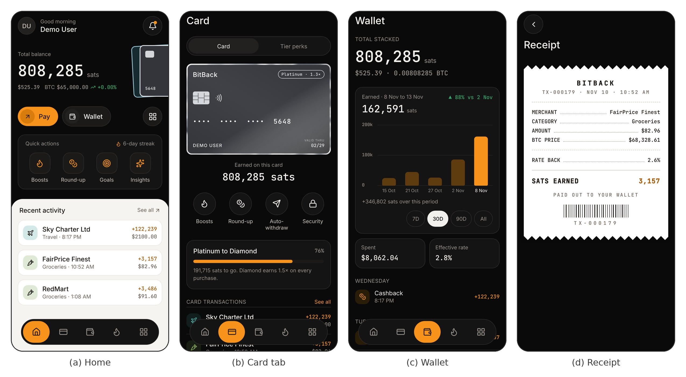

# BitBack — bitcoin cashback card

[](https://github.com/JEEPSSS/Credit-card-with-bitcoin-cashback-system-BitBack/actions/workflows/ci.yml)
[](https://github.com/JEEPSSS/Credit-card-with-bitcoin-cashback-system-BitBack/releases/latest)
[](https://testflight.apple.com/join/Bg5kgsmC)
[](https://jeepsss.github.io/Credit-card-with-bitcoin-cashback-system-BitBack/)

A card that pays cashback in satoshis instead of points, with two machine-learning
models (fraud detection, earnings forecast) and four rule engines (boost
recommender, spending persona, reward engine, gamification) running on the
user's own transaction history. FastAPI backend, Expo (React Native) mobile app.
Final Year Project, College of Computing and Data Science, NTU.



<sub>The current app (preview 4) with the demo account: Home, the Card tab, Wallet and a transaction receipt.</sub>

## Get the app

| | How | Current version |
|---|---|---|
| **Android** | [Download bitback.apk](https://github.com/JEEPSSS/Credit-card-with-bitcoin-cashback-system-BitBack/releases/latest/download/bitback.apk) on the phone and open it (allow "install unknown apps" when asked). It installs over an earlier preview and keeps your sign-in. | [Preview 4](https://github.com/JEEPSSS/Credit-card-with-bitcoin-cashback-system-BitBack/releases/tag/v1.0.0-preview.4) |
| **iPhone** | Install [TestFlight](https://apps.apple.com/app/testflight/id899247664), open the [BitBack invitation](https://testflight.apple.com/join/Bg5kgsmC), tap **Accept**, then **Install**. Updates arrive over the air: open the app, close it, open it again. | Same code as preview 4 |

**Demo account:** `demo@bitback.app` / `demo12345`, or create your own.
Purchases and bitcoin are simulated: no real money or bitcoin is ever moved.

Preview 4 brings a redesigned Home, a Card tab, a floating dock for the tab
bar, Wallet charts with range chips, and a receipt for every transaction.

## Links

- **Project site:** https://jeepsss.github.io/Credit-card-with-bitcoin-cashback-system-BitBack/
- **Live API:** https://bitcoin-survey.onrender.com ([health check](https://bitcoin-survey.onrender.com/api/health),
  [interactive docs](https://bitcoin-survey.onrender.com/docs)). It runs on
  Render's free tier and sleeps when idle, so the first request can take up to
  a minute; the app shows "Waking up the server..." while it does.
- **Documentation:** [architecture](docs/ARCHITECTURE.md) ·
  [architecture review](docs/ARCHITECTURE_REVIEW.md) ·
  [evaluation](docs/EVALUATION.md) ·
  [backend hardening](docs/BACKEND_HARDENING.md) ·
  [app audit](docs/APP_AUDIT.md) ·
  [shipping updates to phones](mobile/LAUNCH.md)
- **Research survey:** https://bitcoin-survey.onrender.com/survey/
- **Privacy policy:** https://bitcoin-survey.onrender.com/privacy

## Run it

**Backend**

```bash
pip install -r requirements.txt
cp .env.example .env
alembic upgrade head                      # create the schema
python seed_demo.py                       # 120 days of demo history
uvicorn main:app --reload --host 0.0.0.0 --port 8000
```

`--host 0.0.0.0` matters: a phone on the same network cannot reach `127.0.0.1`.
SQLite is used by default so there is nothing to install; set `DATABASE_URL` in
`.env` to point at Postgres instead.

**Mobile app**

```bash
cd mobile
npm install
npx expo start
```

Scan the QR code with Expo Go. The app derives the API host from the address
Expo is already serving on, so no configuration is needed on the same network.
Override with `EXPO_PUBLIC_API_URL` to point at a deployed backend.

Demo login: `demo@bitback.app` / `demo12345` (filled in automatically only in a development
build; in the installed app, type it in or create your own account)

**Tests**

```bash
pytest                    # 253 backend tests, each on its own in-memory database
TEST_DATABASE_URL=postgresql://... pytest   # the same suite on Postgres (+2 race tests)
ruff check app main.py seed_demo.py tests evaluation scripts
cd mobile && npm test     # 91 front-end tests
```

How the backend was hardened for production, with evidence for each finding:
[docs/BACKEND_HARDENING.md](docs/BACKEND_HARDENING.md). The app's audit against WCAG 2.2,
Nielsen's heuristics, OWASP MASVS and Android core app quality, with what was fixed:
[docs/APP_AUDIT.md](docs/APP_AUDIT.md).

## Layout

```
app/
  config.py             settings, validated once at import
  clock.py              the one source of UTC time
  reward_engine.py      cashback maths, levels, round-up      (pure, testable)
  gamification.py       streaks and the ten badges
  anomaly_detector.py   Isolation Forest fraud scoring
  ml_forecast.py        weekly level smoothing + window mean, 80% interval
  smart_recommender.py  boost suggestions ranked by expected value
  spending_persona.py   nearest-centroid cosine classification
  services.py           wallet, referral and alert operations
  rate_limit.py         fixed-window limiter
  auth.py               JWT (PyJWT), bcrypt, TOTP helpers
  routers/              14 modules, one per resource group (51 API operations in all)
  models.py schemas.py database.py btc_service.py
main.py                 app assembly: config, middleware, lifespan, routers
migrations/             Alembic; `alembic upgrade head`
seed_demo.py            demo data generator
tests/                  pytest
mobile/                 Expo app (25 screens)
```

## The models and rule engines

| Component | Job | How | Evaluated result |
|---|---|---|---|
| Isolation Forest | Score each transaction for fraud | 6 features relative to the user's own history, plus a never-seen-hour check | F1 0.89 [0.86, 0.91] on 30 held-out seeds; beats the rule baseline on all 30 |
| Earnings forecast | Next 30 days of sats, with an 80% range | Weekly level smoothing blended with the window mean | Beats "same as last month" for steady and growing spending |
| Boost recommender | Which category boost to activate | Ranked by expected boost value (spend x rate) | Best category 70% vs 61% for the original weighted score |
| Spending persona | Which of five personas you are | Nearest centroid, cosine similarity, after 20 purchases | 75.5% right and calibrated at 20 purchases |
| Reward engine | Cashback in sats | Pure arithmetic | 0 violations across 200,000 random purchases |
| Gamification | Streaks, badges, levels | Badge rules in SQL | Attainment simulated for light/regular/heavy users |

Every component is evaluated against known ground truth and simple baselines,
with 95% confidence intervals: [docs/EVALUATION.md](docs/EVALUATION.md)
(`python -m evaluation.run` reproduces every number). Five of them changed
because of what the evaluation found; each change was chosen on validation
data and confirmed on separate held-out data.

Several of these needed real debugging rather than tuning, and the reasoning is
written into the module docstrings:

- **Fraud scoring flagged 99% of transactions.** Two causes. Training rows were
  built against progressively shorter histories, so the oldest rows had
  degenerate features that dragged the decision boundary. And when scoring
  backfilled data the history query included transactions *after* the one being
  scored, so "time since last transaction" was zero for every query point and
  positive for every training row. With both fixed, the flag rate matches the
  `contamination=0.05` hyperparameter, and the score scale is anchored to it
  (60 at the model's own outlier boundary) rather than picked by hand. The alert
  line was later moved to 56 on validation data (docs/EVALUATION.md).
- **The forecast predicted 10x the observed rate.** Daily sats earned is
  zero-inflated, which destabilises exponential smoothing, and undamped Holt's
  extrapolates the last trend forever. Weekly aggregation fixed the first. The
  trend term was later removed altogether, because backtests showed it losing to
  "same as last month" (docs/EVALUATION.md); the model is verified against flat,
  growing, and collapsing synthetic series in `tests/test_models_ml.py`.
- **Every new account was told its earnings were growing.** The lookback window
  is thirteen weeks, so a user active for three of them had ten empty weeks
  prepended to their series — weeks before the account existed, counted as weeks
  in which they earned nothing. A flat 10,000 sats/week fits a slope of
  +824/week that way. Leading empty weeks are now trimmed; interior zeros are
  kept, because a quiet week inside an active history is real signal.
- **A sustained decline reported as "stable".** The trend label was read from
  Holt's trend state, which damping deliberately shrinks to about 43% of the
  true weekly slope, and compared against 5% of the mean. The label now comes
  from the least-squares slope, which is what actually describes the series.
- **Deleting a user left orphaned rows.** SQLAlchemy's bulk `query().delete()`
  bypasses ORM cascade rules. Object-level `db.delete()` is required.

**Fraud scoring latency.** Training used to run inside every request, with a
flat ~110 ms for the fit itself. A fitted model is now cached per user and refit
only after `FRAUD_REFIT_INTERVAL` (25) new transactions, so the request path is
usually one `decision_function` call. From `python -m evaluation.run`; absolute
times vary with the machine:

| History | Cold (refit) | Warm (cached, median) | Amortised over 25 |
|---|---|---|---|
| 135 transactions | 132 ms | 5.5 ms | 10.6 ms |
| 340 transactions | 239 ms | 10.7 ms | 19.8 ms |
| 687 transactions | 413 ms | 18.6 ms | 34.3 ms |

## Design

Colour values derive from the Radix Colors dark scale and are checked against
WCAG 2.2 AA. Touch targets are 48dp, satisfying both the Apple HIG 44pt minimum
and Material 3's 48dp. Type is a 1.25 modular scale anchored at 16 — five sizes,
one step deliberately skipped between `title` and `display`. Spacing is a 4pt
grid. Two corner radii.

Every one of those values lives in `mobile/lib/theme.ts` with the constraint it
derives from, and the screens import them. That was not previously true: the
file documented a system nothing referenced, colours lived in a component, a
third token set sat unused in a Tailwind stylesheet, and the app used thirteen
distinct font sizes against the six documented. A unit test now asserts the
scale is what the comment says it is.

Motion is limited to four places: the balance odometer, the metal rim on the
card, the beam round an active boost, and the pill that slides to the active
tab in the dock. Under the system reduce-motion setting the rim holds still
and the beam is not drawn.
Transactions render as receipt lines sharing one hairline rule with a
right-aligned tabular-mono column, so figures align vertically down the screen.

## Scope note

The brief this was built from specified five models. The code has two learned
models (the fraud detector and the forecast) and four rule engines (the boost
recommender, the persona classifier, the reward engine and gamification); the
recommender and persona are deterministic scoring functions, not machine
learning, and the app says "four models" for the four it explains on the AI
insights screen. All six are evaluated, the rule engines included, in
[docs/EVALUATION.md](docs/EVALUATION.md).

## What is not built

- No real Bitcoin transactions. Withdrawal addresses are stored but nothing is
  broadcast, and no private keys exist anywhere in the codebase.
- No email other than password resets. With `RESEND_API_KEY`, `EMAIL_FROM`
  and `PUBLIC_BASE_URL` set (DEPLOY.md), "Forgot password" emails a one-time
  link to a reset page served by the API; without them it says emailed resets
  are unavailable. `DEMO_MODE` also returns the token in the API response so
  the flow can be shown without a mail account; with it off the endpoint
  reveals nothing about whether an address is registered.
- No evaluation on real data. Every result in docs/EVALUATION.md is measured
  against synthetic cardholders whose correct answers are known by
  construction, with separate validation and held-out seeds; real cardholders
  and real fraud will differ.
